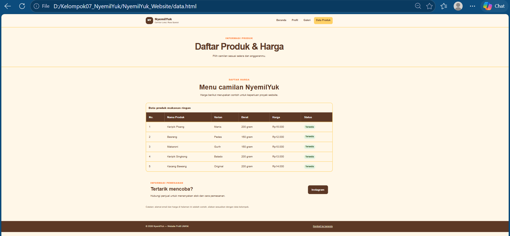
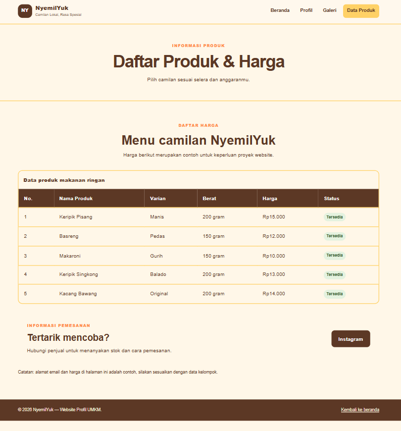
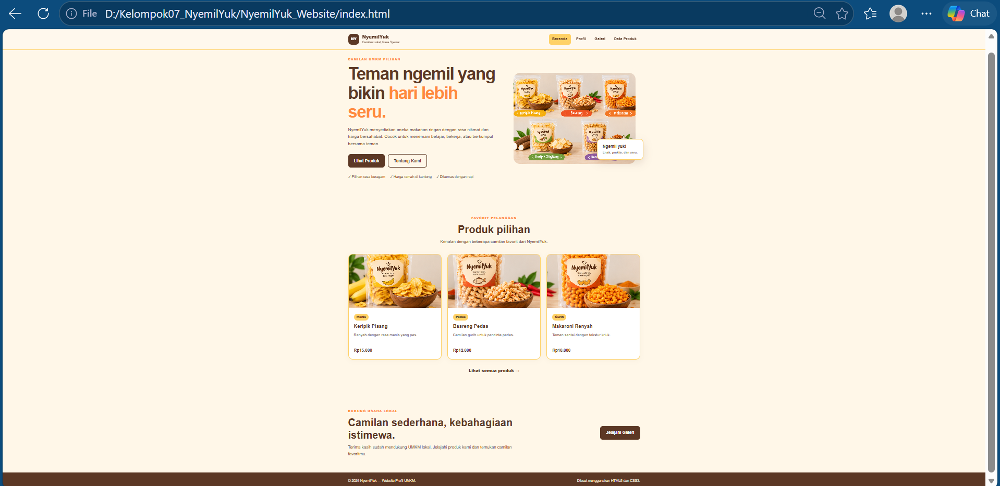
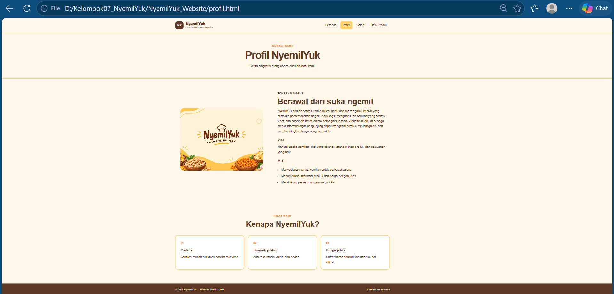
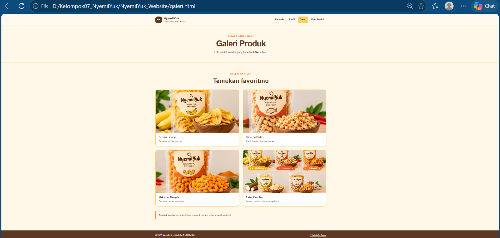
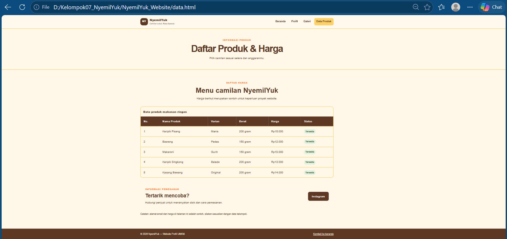

NyemilYuk - WEBSITE PROFIL UMKM
================================

Deskripsi:
Website profil sederhana untuk usaha makanan ringan UMKM "NyemilYuk".
Dibuat menggunakan HTML5 dan CSS3 murni, tanpa JavaScript, Bootstrap,
Tailwind, CMS, atau template siap pakai.

Anggota Kelompok:
-----------------
1. [Irvan Indra Mustofa] - [4525210107] - [Membuat README]
2. [Rayza Aqsha Aditya ] - [4525210101] - [Merancang visual code]
3. [Theofani Natanya Anari Hutabarat] - [4525210074] - [Merancang visual code]
4. [Aqsa Ibnu Rizik] - [4525219193] - [Merancang visual code]
4. [Harisa Malfa Liya] - [4525210027] - [Membuat PPT]

Struktur folder:

NyemilYuk_Website/

|-- index.html

|-- profil.html

|-- galeri.html

|-- data.html

|-- README.md

|-- assets/

    |-- css/
        |-- style.csS
    |--images/
        |-- camilan.png
        |-- keripik.png
        |-- basreng.png
        |-- makaroni.png
        |-- beranda.png
        |-- profil.png
        |-- galeri.png
        `-- data produk.png
        
Cara menjalankan:
1. Ekstrak file ZIP.
2. Buka folder NyemilYuk_Website di VS Code.
3. Buka index.html menggunakan browser.
4. Gunakan menu navigasi untuk membuka halaman lainnya.

Materi yang diterapkan:
-----------------------
- HTML5: struktur halaman, heading, paragraf, dan semantic elements.
- Media: gambar produk lokal (PNG/JPEG) beserta atribut alt.
- Hyperlink: navigasi antarhalaman dan tautan Instagram.
- List: daftar manfaat dan misi usaha.
- Tabel: data produk dan harga.
- CSS3: warna, tipografi, border, spacing, dan hover.
- Flexbox: navigasi, kartu produk, galeri, dan tata letak.
- Media query: penyesuaian tampilan tablet dan HP.
 
 
Sumber Gambar:
--------------
DESKTOP

MOBILE

BERANDA

PROFIL

GALERI

DATA PROUK

Font:
-----
- Font yang digunakan : Arial (fallback: Helvetica, sans-serif)
- Sumber font         : Web Safe Font / Font bawaan sistem operasi dan browser
